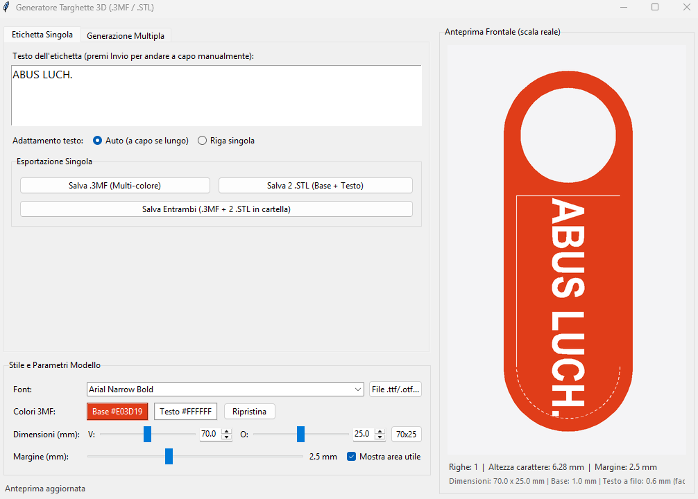

# Generatore Targhette 3D (`.3MF` / `.STL`)

Applicazione desktop in Python per generare targhette/portachiavi personalizzati pronti per la stampa 3D multi-colore, basata sui modelli di riferimento presenti in `modelli/` (`San_P_0`, `San_P_1`, `San_P_2`).



## Funzionalità principali

- **Tre modelli selezionabili**:
  - **`San_P_0` (Pillola verticale)**: altezza **60–80 mm** (predefinita **70 mm**), larghezza **20–30 mm** (predefinita **25 mm**), foro superiore ad anello e testo verticale.
  - **`San_P_1` (Rettangolare orizzontale)**: larghezza **70–90 mm** (predefinita **80 mm**), altezza **41–61 mm** (predefinita **51 mm**), angoli arrotondati (`r = 2 mm`), foro in alto a sinistra (`Ø 8 mm`) e testo orizzontale.
  - **`San_P_2` (Circolare)**: diametro **30–40 mm** (predefinito **35 mm**, variazione `±0.5 cm`), foro superiore (`Ø 5 mm`), bordino circolare esterno opzionale da `1.0 mm` e testo orizzontale.
- **Due stili di rilievo selezionabili su tutti i modelli**:
  - **A filo (`0.4–1.0 mm`, *face-down*)**: base `1.0 mm` con sede incassata e testo a filo `0.6 mm` tramite sottrazione geometrica 2.5D senza sovrapposizioni, pronto per stampa capovolta sul piatto.
  - **In rilievo (`1.0–1.6 mm`)**: base piena `1.0 mm` con testo in rilievo `0.6 mm` sopra la superficie (totale `1.6 mm`).
- **Adattamento automatico e allineamento del testo**:
  - Supporto sia a **riga singola** che a **più righe** (a capo manuale con `Invio` oppure automatico se il testo è troppo lungo), con allineamento **Centro** o **Sinistra**.
  - Ridimensionamento automatico al massimo formato leggibile entro il margine configurabile (`1.0–5.0 mm`) dal bordo e dal foro.
- **Font e colori personalizzabili**:
  - Selezione tra tutti i font di sistema Windows (predefinito `Arial Narrow Bold`) oppure caricamento di un file `.ttf` / `.otf` personalizzato.
  - Scelta dei due colori per il file `.3mf` (predefiniti `#E03D19` per l'etichetta e `#FFFFFF` per il testo).
- **Esportazione flessibile**:
  - **`.3MF` multi-colore** (struttura compatibile Bambu Studio / OrcaSlicer con due estrusori separati: `Etichetta` ed `Testo`, più miniatura dinamica).
  - **2 file `.STL` separati** (`*_base.stl` e `*_testo.stl`) già allineati e orientati *face-down* sul piatto.
- **Generazione Multipla (Batch)**:
  - Creazione automatica in serie da elenco incollato o importato da file `.txt` / `.csv` (una targhetta per riga; usa `|` per forzare l'a capo).

## Requisiti

- Windows 10 / 11 con **Python 3.11+** (oppure gestito automaticamente da `uv`)
- **[uv](https://docs.astral.sh/uv/)** (gestore di pacchetti e ambienti virtuali Python)

Installazione rapida di `uv` su Windows (PowerShell):

```powershell
powershell -ExecutionPolicy ByPass -c "irm https://astral.sh/uv/install.ps1 | iex"
```

## Installazione e Avvio

### Metodo rapido (consigliato)

Fai doppio clic su **`avvia.bat`**.  
Al primo avvio lo script crea automaticamente l'ambiente virtuale `.venv` tramite `uv sync` usando `pyproject.toml` e `uv.lock`, quindi avvia l'interfaccia grafica.

### Metodo manuale da terminale

```powershell
git clone https://github.com/AmboniRider/targhette.git
cd targhette
uv sync
.venv\Scripts\python.exe app.py
```

## Istruzioni d'uso

1. **Etichetta Singola**:
   - Scrivi il testo nella casella superiore (usa `Invio` per andare a capo manualmente, oppure lascia attiva l'opzione **Auto**).
   - Regola font, colori, dimensioni (`V` e `O`) e margine nella sezione **Stile e Parametri Modello** osservando l'anteprima in tempo reale a destra.
   - Clicca **Salva .3MF (Multi-colore)** per ottenere un unico file pronto per Bambu Studio / OrcaSlicer, oppure **Salva 2 .STL (Base + Testo)** / **Salva Entrambi**.
2. **Generazione Multipla**:
   - Passa alla scheda **Generazione Multipla**, inserisci un testo per riga (o carica un file `.txt`/`.csv`), scegli i formati e la cartella di destinazione, poi clicca **Genera Tutte le Targhette**.
3. **Stampa nello Slicer (Bambu Studio / OrcaSlicer)**:
   - Apri il file `.3MF`: `Etichetta` (estrusore 1) e `Testo` (estrusore 2) sono già separati e puoi cambiare il filamento/colore di ciascuna parte con un clic.
   - Se usi i due `.STL`, trascinali insieme sullo stesso piatto confermando di caricarli come un unico oggetto a più parti, quindi assegna gli estrusori a `*_base.stl` e `*_testo.stl`.

## Struttura del repository

- `app.py` — Interfaccia grafica desktop Tkinter e flusso di esportazione singola/batch
- `tag_generator.py` — Motore geometrico 2D/3D, estrazione glifi TTF/OTF ed esportatori `.3MF` e `.STL`
- `avvia.bat` — Script di avvio automatico con `uv`
- `pyproject.toml` / `uv.lock` — Dipendenze e lockfile riproducibile
- `modelli/` — Modelli 3D di riferimento (`San_P_0`, `San_P_1`, `San_P_2` in `.3mf` e `.stl`)
- `screenshot.png` — Anteprima dell'interfaccia dell'applicazione
